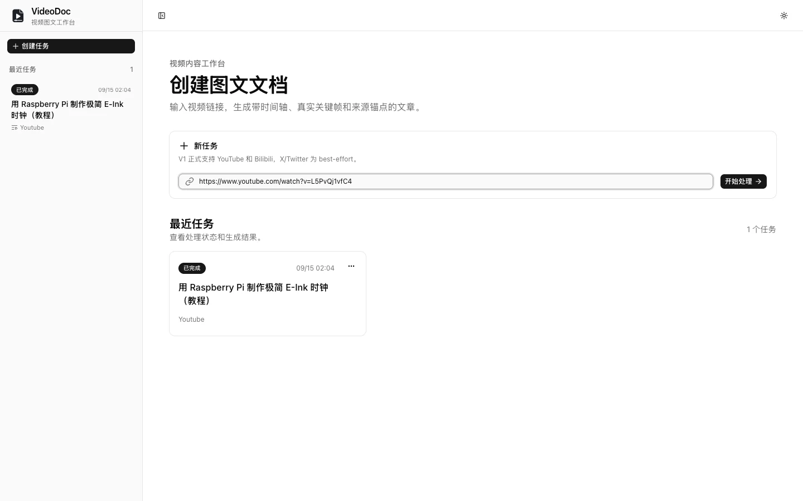
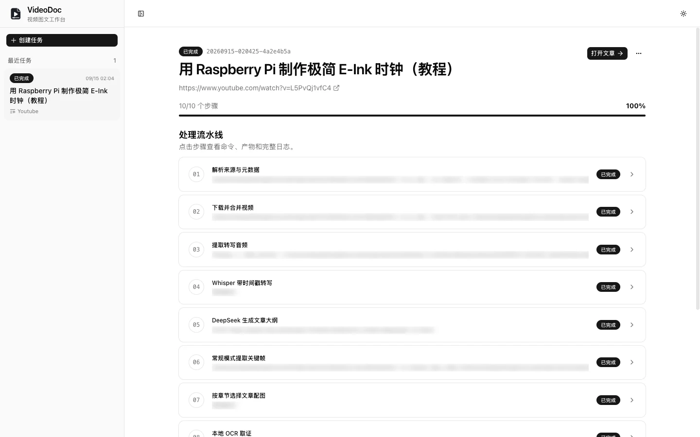
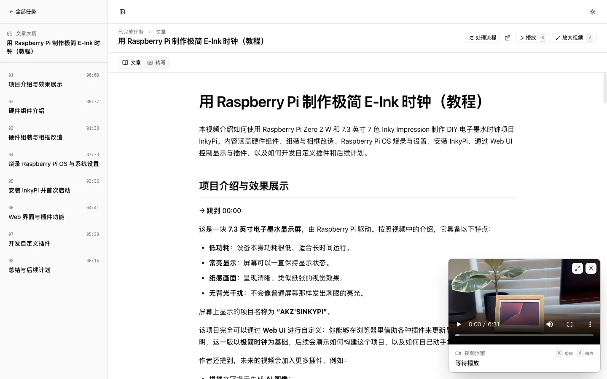

# VideoDoc

**把视频链接转成一篇带时间锚点的中文图文文章。**

[](LICENSE)

## 它做什么

粘贴一个 YouTube 或 Bilibili 链接，VideoDoc 会下载视频、生成带时间戳的转写、
用 LLM 拆分大纲并按章节写正文、提取关键帧选配图（macOS 上还会做本地 OCR 取证），
最终产出一篇带配图的图文文章。

## 操作流程

**1. 粘贴链接**

把 YouTube / Bilibili 链接粘进输入框，点「开始处理」。



**2. 看进度**

任务页会列出十个阶段，从解析来源、下载、转写到抽帧、写稿、收尾。
每个阶段只执行一次，失败会停下来等你在页面上点「重试当前阶段」。



**3. 读文章**

完成后打开文章：左侧是大纲，中间是正文与配图，右下是视频浮窗。



### 怎么用

点左侧大纲的任意章节，**文章和视频会同时跳到那个位置**，但视频不会自动播放：
原本暂停就保持暂停，只更新画面；原本在播放则继续播放。
点正文里的「→ 跳到 00:37」或任意配图，视频会跳过去并开始播放；
切到「转写」标签点任一片段，视频同样跳到对应时间点并开始播放。

桌面端快捷键（输入框聚焦时不生效）：

| 键 | 作用 |
|---|---|
| `Space` | 播放 / 暂停 |
| `V` | 切换视频浮窗尺寸 |
| `F` | 进入 / 退出浏览器全屏 |
| `Esc` | 从最大化或全屏退回小窗 |

浮窗尺寸按来源分两套循环：小窗按 `V` 最大化，再按 `V` 回到小窗；浮窗已关闭时按 `V` 直接以最大化打开，再按 `V` 关闭。想从最大化回到小窗，按 `Esc`，或点浮窗右上角、顶栏上的「缩小」按钮。

`F` 或浮窗里的全屏按钮会请求浏览器全屏（地址栏和标签栏一起隐藏，视频铺满屏幕）；退出全屏后回到进入前的尺寸，不会覆盖你保存的小窗位置和大小。

## 快速开始

需要 **Python 3.11+**、**Node 20.19+ 与 pnpm**、**FFmpeg**。

```bash
git clone https://github.com/Shadowzzh/VideoDoc.git
cd VideoDoc

cp .env.example .env      # 填 VIDEODOC_LLM_API_KEY（唯一必填项）
./scripts/serve.sh        # 自动建 venv、装依赖、构建前端
```

打开 <http://127.0.0.1:8765/app/>。换端口：`./scripts/serve.sh 9000`。

<details>
<summary>或手动分步执行</summary>

```bash
python3 -m venv .venv
.venv/bin/pip install -e .
pnpm --dir frontend install && pnpm --dir frontend build
.venv/bin/videodoc --port 8765
```

</details>

## 平台支持

除本地 OCR 外全部跨平台。

| 能力 | 范围 |
|---|---|
| 下载 / 转写 / 抽帧 / LLM / 网页界面 | 全平台（macOS 转写自动启用 Metal） |
| **本地 OCR**（读取配图文字） | **仅 macOS**；其他平台记录日志并跳过，任务继续 |

## 配置

两个入口，**网页设置优先于环境变量**：

* **网页设置**（`/app/settings`）：改完对**新任务**立即生效，不用重启服务；
  落在 `~/.config/videodoc/settings.json`（权限 600，可用 `VIDEODOC_SETTINGS_FILE` 改路径）。
* **环境变量 / `.env`**：提供默认值，也适合无头部署。

| 设置分类 | 能配什么 |
|---|---|
| **文本模型** | 大纲和正文的 BaseURL、模型、Key（明文或密钥文件）、超时、重试与输出 token 上限 |
| **图像识别** | 本地 macOS Vision OCR 与云端视觉模型的通道、端点、预算 |
| **配音** | TTS 服务地址、声音 ID、语气强度、变速上限、分离方式、BGM 音量、字幕黑条 |

环境变量完整清单见 [`.env.example`](.env.example)，常用的几项：

| 变量 | 默认值 | 说明 |
|---|---|---|
| `VIDEODOC_LLM_API_KEY` | — | **必填**（也可以只在网页设置里填） |
| `VIDEODOC_LLM_BASE_URL` | `https://api.deepseek.com` | 任意 OpenAI 兼容端点 |
| `VIDEODOC_LLM_MODEL` | `deepseek-v4-flash` | 模型名 |
| `VIDEODOC_WHISPER_MODEL` | `large-v3-turbo` | 模型名或本地 `.bin` 路径 |
| `VIDEODOC_COOKIE_BROWSER` | `chrome` | 读取哪个浏览器的登录态；设为空则完全关闭 |
| `VIDEODOC_RUNTIME_DIR` | `~/.local/share/videodoc` | 运行产物目录 |

`VIDEODOC_WHISPER_MODEL` 保持默认时，首次运行会自动下载约 1.5GB 的模型。
网络受限可先自行下载 `ggml-*.bin`，再用该变量指向本地文件；
体积敏感也可以用更小的档位，例如 `large-v3-turbo-q5_0`（约 570MB）。

## 配音

把中文译文配成本人声音，替换原片人声、保留背景音乐，并烧上中文字幕。

### 链路

```text
zh.srt → 合并短段 → LLM 写配音稿 → Ming TTS 逐段合成
  → 按原时间轴对齐（变速上限 1.15）→ demucs 分离原人声
  → 配音 + BGM 混音 → 烧字幕 → dubbed.mp4
```

### 成片与播放

`video/dubbed.mp4` 的音轨是混音结果（配音 + 背景音乐），字幕烧成硬字幕；
原始视频 `video/source.mp4` 保持不变。烧字幕时必须把 `dub/mixed.wav` 作为音轨传入
（`burn_subtitles(audio=…)`）——早期版本只 `-c:a copy` 复制原音轨，结果成片只有字幕、
听不到配音。

结果接口会把 `result.json` 的 `video` 改写为 `video/dubbed.mp4`（保留
`video_original` 与 `dubbed: true`），所以补过配音的任务打开结果页直接播配音版，
面包屑显示「配音版」徽标。

### 人声分离

| 通道 | 106 秒音频 | 何时用 |
| --- | --- | --- |
| 容器内 CPU demucs | ~2 分钟 | 默认兜底 |
| Ray GPU（`demucs` profile） | 4 秒 | 配了 Ray 时自动优先 |

Ray 侧的镜像与 profile 见 Ops 仓库 `hosts/workhorse/demucs-gpu/`。设置页
「分离方式」可选：自动（优先 Ray）/ 本地 CPU / 强制 Ray GPU。

### 进度可视化

配音在任务页「处理流程 → 配音」里拆成 8 个阶段：

```text
准备字幕 → 合并单元 → LLM 写稿 → TTS 合成 → 时长对齐 → 人声分离 → 混音 → 烧字幕
```

每个阶段记录状态、耗时和一句话摘要（例如「16/16 段」「ray」「已烧入中文字幕」）；
TTS 阶段再往下拆到每一段，点「16 段 · 16 段完成」展开可见每段文本、缓存命中与耗时。

数据结构是 `task.json` 里 dub step 的 `stages[]`，每项可带 `items[]`，前端按 1.5 秒轮询刷新。

### 缓存

* `dub/manifest.json`：按「文本 + 声音」哈希缓存每段 TTS，重跑只合成改过的段
* `dub/script-cache-<key>.json`：按「原文 + tone + squeeze」缓存配音稿，
  避免 LLM 措辞漂移导致所有 TTS 缓存失效

### 配置项

| 项 | 默认 | 说明 |
| --- | --- | --- |
| 语气强度 | 5 | 0 严肃，10 放飞；只影响配音稿，字幕始终忠实翻译 |
| 变速上限 | 1.15 | 句子超时最多压缩多少倍 |
| 分离方式 | 自动 | 自动 / 本地 CPU / 强制 Ray GPU |
| 背景音乐音量 | 0.4 | 相对原音量；1.0 会盖住配音 |
| 字幕黑条 | 开 | 底部铺半透明黑带 |

## 已知限制

- 单用户、单 worker，任务顺序执行；JSON 文件存储，不引入数据库
- 正式验收 YouTube 与 Bilibili；X 仅 best-effort
- 本地 OCR 仅 macOS 可用
- 删除任务走可恢复回收站（等待中也可删，仅运行中拒绝），暂无网页端恢复入口

  回收站默认在 `~/.local/share/videodoc/trash/`（可用 `VIDEODOC_RUNTIME_DIR`
  改数据根目录），任务目录名是 `<task-id>-<删除时间>`，需要恢复时移回：

  ```bash
  mv ~/.local/share/videodoc/trash/<task-id>-<YYYYMMDD-HHMMSS> \
     ~/.local/share/videodoc/tasks/<task-id>
  ```

## 开发

```bash
.venv/bin/pip install -e ".[dev]"
.venv/bin/python -m pytest -q        # 85 项，不访问网络
pnpm --dir frontend typecheck
pnpm --dir frontend test
```

```text
videodoc/
├── cli.py / config.py / server.py
├── pipeline.py            # 十步流水线
├── task_store.py          # JSON 状态与断点续跑
└── integrations/          # crv 抽帧、whisper 转写、macOS OCR
frontend/                  # React + TypeScript + Vite + Tailwind + shadcn/ui
examples/                  # 示例产物（/sample 展示用）
```

流水线：`probe → download → audio → transcribe → outline → frames → select_images → ocr → article → finalize`

### 前端长文本约定

任务没有文章标题时 `taskTitle` 会退回原始分享链接，抖音链接常有 300+ 字符且
不含空格，渲染时按下面两条处理，否则会撑出容器：

- 固定宽度的容器（确认框、卡片、提示块）用 `[overflow-wrap:anywhere]`；
  `break-words`（`overflow-wrap: break-word`）不参与 min-content 计算，
  Grid/Flex 的 `auto` 轨道仍会被长串撑开。
- 需要硬约束的网格容器把列轨道写成 `grid-cols-[minmax(0,1fr)]`，
  并在确认框一类弹窗里给 `max-h-[calc(100dvh-2rem)]` 兜底。

## 许可

[MIT](LICENSE)
